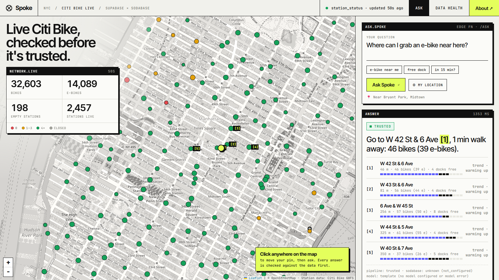
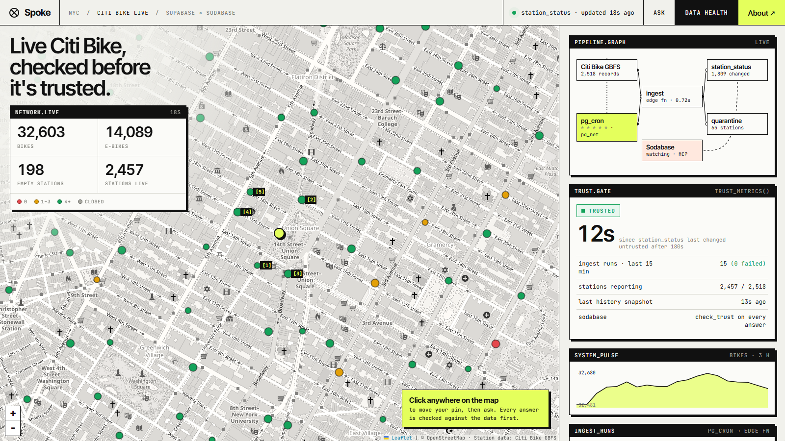
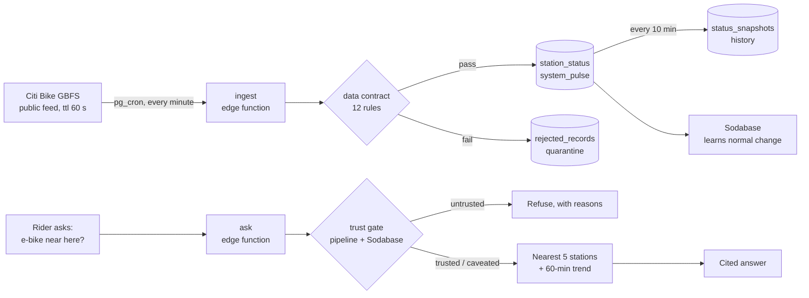
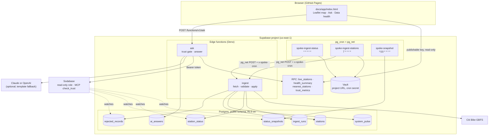
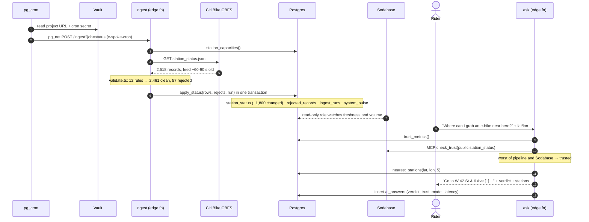

# Spoke

**Live Citi Bike availability for New York, checked before it's trusted.**

You're walking to a Citi Bike dock and the app says there are three bikes. You get there and there are none. Was the data wrong, old, or just unlucky? Spoke pulls the public Citi Bike feed into **Supabase** every minute with **pg_cron** and an **edge function**, checks every record against a written data contract, and quarantines what fails. It's not hypothetical: on the first pull, 48 stations reported a 1970 timestamp and 9 reported more bikes than they have docks. Ask Spoke "where can I grab an e-bike near here?" and it first runs a **trust gate**: Spoke's own pipeline health plus **Sodabase**'s verdict on the table. If the data can't be trusted, Spoke says so and refuses to guess. If it can, it answers from the nearest live stations and their 60-minute trend, citing each one.

Built by **Paras Adlakha** and **Harshita Adlakha** for the **Supabase + Sodabase + BuilderBase NYC Hackathon** (4 November 2026).

**▶️ [Open the live app](https://parasadlakha.github.io/spoke/app/)** · [Data health view](https://parasadlakha.github.io/spoke/app/#health) · **🎬 [2-minute demo](docs/video/Spoke-demo-2min.mp4)** · [3-minute pitch](docs/video/Spoke-pitch-3min.mp4) · **📑 [Slides (PDF)](docs/slides/Spoke-slides.pdf)** · [PowerPoint](docs/slides/Spoke-slides.pptx) · [Project page](https://parasadlakha.github.io/spoke/) · [Market brief](docs/market-brief.html)



*The live app. Left: every installed Citi Bike station, coloured by bikes available, with the cited stations tagged [n]. Right: the answer, its trust verdict, and each station with live counts.*



*Data health: the pipeline as a graph with live counts, the trust gate the answer was checked against, and one `system_pulse` point per minute.*

**Contents:** [The hackathon](#the-hackathon) · [The problem](#the-problem) · [What Spoke does](#what-spoke-does) · [Architecture](#architecture) · [How one minute and one answer are handled](#how-one-minute-and-one-answer-are-handled) · [The data contract](#the-data-contract) · [The trust gate](#the-trust-gate) · [Built for Sodabase](#built-for-sodabase) · [Read-only by construction](#read-only-by-construction) · [Guardrails](#guardrails) · [Supabase features used](#supabase-features-used) · [Real numbers](#real-numbers) · [Tests](#tests) · [Run it yourself](#run-it-yourself) · [Repository layout](#repository-layout) · [What we learned](#what-we-learned) · [Limitations and roadmap](#limitations-and-roadmap) · [Team](#team) · [References](#references)

---

## The hackathon

| | |
|---|---|
| **Event** | Supabase + Sodabase + BuilderBase NYC Hackathon, Midtown Manhattan |
| **Date** | Wednesday 4 November 2026, 4–8 PM EST, in person |
| **Challenge** | *Your code works. But is your data any good?* Build on Supabase tables, cron jobs and edge functions; connect Sodabase, which learns how the tables normally change |
| **Judging** | Craft, execution and the **Sodabase Data Quality Score**: Sodabase checks for stale, empty or wrong data |

### What the challenge asks for, and where it is in Spoke

| Ask | Spoke |
|---|---|
| Supabase tables | 7 tables in `public`, with `CHECK` constraints and row-level security ([migration](supabase/migrations/20261104000001_spoke_schema.sql)) |
| Cron jobs | 3 `pg_cron` jobs: live status every minute, stations hourly, history every 10 minutes ([migration](supabase/migrations/20261104000003_spoke_cron.sql)) |
| Edge functions | `ingest` (called by pg_cron via `pg_net`) and `ask` (the trust-gated answer) ([`supabase/functions`](supabase/functions)) |
| Connect Sodabase | Read-only connection to the project; Sodabase's MCP `check_trust` is called on every answer when a token is set ([`sodabase.ts`](supabase/functions/_shared/sodabase.ts)) |
| Data that isn't stale | Every table has a timestamp that Sodabase can read; the live and history tables move on a steady rhythm, and a failed run still writes a row, so silence is visible |
| Data that isn't empty | No truncation or deletion anywhere; history is insert-only |
| Data that isn't wrong | Every record passes a written contract before it's saved; failures are quarantined with a reason |

---

## The problem

Bike-share availability is the classic "the data said so" failure.

- Citi Bike is the largest bike-share system in North America: about **2,500 stations** across NYC, Jersey City and Hoboken, and a record **44.3 million trips in 2024**.
- Station status comes from a public GBFS feed that hundreds of apps, maps and dashboards read directly. It's good data, but not clean data. On 4 November 2026 it included **48 stations with a `last_reported` of `86400`** (2 January 1970), **9 stations reporting more bikes and docks than they physically have**, and stations marked "installed" that hadn't reported for over a day.
- An app that passes this through, or an AI assistant that paraphrases it, turns a bad row into a confident wrong answer. A rider walks ten minutes to an empty dock.

**Our bet:** the pipeline should know when it's wrong, and the answer should depend on it. Validate on the way in, record what you rejected and why, monitor freshness and volume continuously, and gate every AI answer on that state.

---

## What Spoke does



| Step | What happens | Where |
|---|---|---|
| **Pull** | pg_cron calls the `ingest` edge function through `pg_net` every minute, with a shared secret from Supabase Vault | `cron.job`, `call_ingest()` |
| **Check** | Each of ~2,500 records goes through the contract: ids, counts, flags, timestamps, capacity, service area | [`validate.ts`](supabase/functions/_shared/validate.ts) |
| **Save** | Clean rows are upserted in one transaction; `updated_at` moves only for stations whose report changed | `apply_status()` |
| **Quarantine** | Failing records go to `rejected_records`, one row per station and reason with a counter | `record_rejects()` |
| **Audit** | Every run, including failures, writes one `ingest_runs` row: rows in, changed, rejected, feed age | `ingest_runs` |
| **Summarise** | One `system_pulse` row per minute: bikes, e-bikes, docks, empty and full stations | `system_pulse` |
| **Remember** | Every 10 minutes, a snapshot of every installed station for trends | `take_snapshot()` |
| **Ask** | Trust gate → nearest stations with trend → an answer citing [n] stations, or a refusal | [`ask`](supabase/functions/ask/index.ts) |

---

### The functions

Everything Spoke does is one of these. The browser can call only the four read-only RPCs and `ask`.

| Function | Kind | What it does | Guardrail |
|---|---|---|---|
| `ingest?job=status` | Edge function, pg_cron every minute | Fetch `station_status`, validate, apply in one transaction | Rejects any call without the `x-spoke-cron` secret from Vault |
| `ingest?job=stations` | Edge function, pg_cron hourly | Fetch `station_information`, validate, upsert `stations` | Same secret; runs automatically on the first status ingest |
| `ask` | Edge function, public | Trust gate → nearest stations → cited answer, logged | Question capped at 300 chars; no model call when untrusted |
| `apply_status` / `apply_stations` | SQL, security definer | Upsert clean rows, record rejects, write the audit row and pulse | `execute` revoked from `anon` and `authenticated` |
| `record_rejects` | SQL, security definer | Upsert the quarantine, counting repeats | Revoked from the browser |
| `take_snapshot` | SQL, pg_cron every 10 min | Copy live status of installed stations into history | Revoked from the browser |
| `call_ingest` | SQL, pg_cron | `pg_net` POST to `ingest`, URL and secret read from Vault | Revoked from the browser |
| `live_stations` / `health_summary` | SQL RPC, public | Everything the map and the Data health view show, in one call | Read-only, `stable` |
| `nearest_stations` | SQL RPC, public | 5 nearest installed stations with live counts and 60-minute trend | Read-only; limit clamped to 1–20 |
| `trust_metrics` | SQL RPC, public | Raw freshness and run-health numbers for the gate | Read-only |

---

## Architecture



**Why so little code?** Spoke is a database with two small functions on top. The cron schedule, the secret store, the HTTP client, the history, the access rules and the read API are all Supabase. The only application logic is the contract and the trust gate, and both are pure TypeScript shared between the Deno functions and the Node tests.

---

## How one minute and one answer are handled



---

## The data contract

Every record is checked before it touches a table. Failing records never reach the live tables; they go to the quarantine with a reason a human can read.

| Rule | Rejects | Seen live on 4 Nov |
|---|---|---|
| `bogus_timestamp` | `last_reported` before May 2013 (Citi Bike launched 27 May 2013) | **48 stations** report `86400` = 2 Jan 1970 |
| `over_capacity` | bikes + docks + disabled > capacity + 2 at an installed station | **9 stations**, e.g. "18 bikes + docks at a 4-dock station" |
| `future_timestamp` | reported more than 5 min in the future | 0 |
| `unknown_station` | status for a station missing from `station_information` | 0 |
| `invalid_count` / `ebikes_exceed_bikes` / `invalid_flag` | non-integer or negative counts, e-bikes > bikes, flags not 0/1 | 0 |
| `duplicate_station` / `missing_station_id` | the same id twice in one feed, or none | 0 |
| `outside_service_area` / `missing_name` / `invalid_capacity` | station list basics | 0 |

Three design choices keep this honest:

1. **Postgres repeats the critical rules as `CHECK` constraints**, so even a bug in the function can't write a negative count, more e-bikes than bikes, or a 1970 timestamp.
2. **A bad batch is applied partially, not dropped.** The 2,461 good stations are still good. If more than 10% of a batch is rejected, or the feed itself is over 5 minutes old, the run is marked `partial`, and the trust gate sees that.
3. **The quarantine doesn't grow every minute.** A decommissioned dock reporting 1970 every minute is one row with `times_seen` counting up, not 1,440 rows a day.

---

## The trust gate

Before `ask` answers, it combines two independent views of the data and takes the worse one ([`trust.ts`](supabase/functions/_shared/trust.ts)).

| Source | Untrusted when | Caveated when |
|---|---|---|
| **Spoke's pipeline** (`trust_metrics()`) | `station_status` is over 3 minutes old · no ingest run in 15 minutes · no data yet | over 90 s old · a failed run in the last 15 minutes · the last run was `partial` · under 80% of stations reporting |
| **Sodabase** (MCP `check_trust` on `public.station_status`) | Sodabase says untrusted | Sodabase says caveated |

- **Untrusted:** no model call. Spoke answers "I won't guess", with the reasons (for example "live data is 12 min old").
- **Caveated:** the answer says briefly why the numbers may be off.
- **Trusted:** the 5 nearest stations, their live counts and their 60-minute trend from `status_snapshots` go into a facts block. The model may only phrase what's in it and must cite stations as [n]. With no model key, a fixed template answers from the same facts, so the app works without any AI provider.
- Sodabase's **unknown** (still warming up, or not connected) never downgrades an answer on its own; Spoke's own checks still apply.

Every answer is logged in `ai_answers` with its verdict, the full trust record, the model and the latency.

---

## Built for Sodabase

Sodabase learns how each table normally changes and flags data that's stale, empty or wrong. Spoke is designed so that "normal" is easy to learn and a real problem is easy to see. Sodabase currently watches four tables: `stations`, `station_status`, `status_snapshots` and `rejected_records`. `ingest_runs`, `system_pulse` and `ai_answers` are not watched; Spoke's own trust gate reads `ingest_runs`.

| Sodabase check | How Spoke's tables behave |
|---|---|
| **Stale** (freshness, from `updated_at` / `created_at`) | `station_status.updated_at`: about 1,800 stations re-report every minute. `status_snapshots`: ~2,450 rows every 10 min, `created_at`, insert-only. A stopped cron shows up within minutes |
| **Empty** (row count drops, truncation) | Nothing is ever deleted or truncated. History tables only grow; `stations` and `station_status` hold ~2,500 rows, upserted in place |
| **Wrong** (schema / shape) | The schema lives only in migrations; nothing alters tables at runtime. Bad values are blocked by the contract and `CHECK` constraints, and recorded in `rejected_records` |

Sodabase connects with its own `soda_readonly` role and never writes. Spoke reads Sodabase back through its MCP server: `ask` opens a Streamable HTTP session at `https://sodabase.io/mcp`, calls `check_trust` with `dataset = public.station_status`, and maps the reply to a verdict. The same MCP server works from Claude Code or Cursor for investigating alerts while building:

```bash
claude mcp add --transport http sodabase https://sodabase.io/mcp
```

---

## Read-only by construction

| Claim | Where it is enforced |
|---|---|
| The browser can't write anything | Row-level security is on for all 7 tables with `select`-only policies; the app uses the publishable key ([schema](supabase/migrations/20261104000001_spoke_schema.sql)) |
| The browser can't trigger an ingest or touch the quarantine | `execute` on `apply_status`, `apply_stations`, `record_rejects`, `take_snapshot`, `call_ingest` and `station_capacities` is revoked from `anon` and `authenticated` |
| Only pg_cron can run `ingest` | The function checks `x-spoke-cron` against `SPOKE_CRON_SECRET`; pg_cron reads the same secret from Vault. Neither is in the repo |
| Sodabase never writes | Sodabase connects as its own `soda_readonly` role, read-only at the transaction level |
| Questions and answers stay private | `ai_answers` has RLS with no `select` policy; only the Data health summary (question, verdict, latency) is exposed |
| No secrets in git | `.env` and `supabase/.temp/` are ignored; `docs/app/config.js` holds only the URL and the publishable key, which RLS limits to reads |

## Guardrails

- **Bad data never reaches the live tables.** Twelve rejection reasons in TypeScript, repeated as Postgres `CHECK` constraints for the critical ones.
- **A failed run is never silent.** Every run writes one `ingest_runs` row, success or failure; no runs in 15 minutes makes the data untrusted.
- **The model only phrases facts.** It gets a facts block built from SQL and must cite stations as [n]; it is told never to invent numbers. With no key, or if the model call fails, a fixed template answers from the same facts.
- **No model call on untrusted data.** The refusal is generated in code, with the reasons.
- **Nothing is deleted.** No `delete`, `truncate` or `drop` runs at runtime, so a row-count drop always means something real.
- **Inputs are bounded.** Questions are capped at 300 characters; `nearest_stations` clamps its limit to 1–20; coordinates fall back to Bryant Park if missing.
- **The UI escapes everything it renders,** including station names from the feed and questions from other users.

---

## Supabase features used

| Feature | Use |
|---|---|
| **Postgres tables + `CHECK` constraints** | 7 tables; the critical contract rules are enforced in the database |
| **pg_cron** | 3 jobs: `spoke-ingest-status` (every minute), `spoke-ingest-stations` (hourly), `spoke-snapshot` (every 10 min) |
| **pg_net** | `call_ingest()` posts to the edge function from inside Postgres |
| **Vault** | The project URL and cron secret, read by `call_ingest()`; never in a migration |
| **Edge functions (Deno)** | `ingest` and `ask`, deployed with `supabase functions deploy --use-api` |
| **Row-level security** | Live tables are public read-only; `ai_answers` isn't readable from the browser; nothing is writable with the publishable key |
| **Security-definer RPCs** | `live_stations`, `health_summary`, `nearest_stations`, `trust_metrics` for the browser; write functions are revoked from `anon` |
| **Supabase CLI** | Project creation, migrations, secrets and deploy, all scripted |
| **supabase-js** | The browser reads through RPCs with the publishable key |

---

## Real numbers

From the deployed project (`spoke-nyc`, us-east-1) on 4 November 2026:

| | |
|---|---|
| Stations ingested | 2,518 |
| Statuses accepted on the first run | 2,461 |
| Quarantined | 57 (48 `bogus_timestamp`, 9 `over_capacity`) |
| Installed stations live | 2,455 |
| Bikes / e-bikes on the network at 19:30 UTC | 32,553 / 14,051 |
| Statuses that change per minute | ~1,800 (each `ingest` run takes ~0.4 s) |
| `ask` latency, trusted path | 1.3–2.1 s end to end (trust metrics, Sodabase call, nearest stations, answer) |

---

## Tests

```bash
npm test
```

22 tests, run with Node's built-in test runner on the same TypeScript files the edge functions import:

| File | Covers |
|---|---|
| [`test/validate.test.ts`](test/validate.test.ts) | Every contract rule rejects with its own reason; the 1970 placeholder from the live feed is quarantined; valet tolerance; duplicates; run status (`ok` / `partial` / `failed`) |
| [`test/trust.test.ts`](test/trust.test.ts) | Healthy → trusted; stopped cron → untrusted; failed or partial runs → caveated; Sodabase can downgrade but "unknown" can't; Sodabase reply parsing doesn't mistake *untrusted* for *trusted*; template answers skip empty stations and warn about draining ones; refusals name the reason |

---

## Run it yourself

You need Node 22.6+, a Supabase account and the Supabase CLI (`npx supabase`).

```bash
git clone https://github.com/ParasAdlakha/spoke && cd spoke
npm install
cp .env.example .env            # fill SUPABASE_PROJECT_REF, SUPABASE_DB_PASSWORD, SPOKE_CRON_SECRET
npx supabase login
npx supabase link --project-ref <your-ref>
npx supabase db push            # tables, functions, RLS, cron jobs
npx supabase secrets set SPOKE_CRON_SECRET=<same as .env>   # optional: ANTHROPIC_API_KEY or OPENAI_API_KEY, SODABASE_TOKEN
npx supabase functions deploy ingest ask --use-api
npm run setup                   # Vault secrets + the first ingest
npm run sql -- "select * from ingest_runs order by id desc limit 5"
```

Then put your project URL and publishable key in [`docs/app/config.js`](docs/app/config.js) and open `docs/app/index.html` (or `npm run serve`). To connect Sodabase, sign in at [sodabase.io](https://sodabase.io) with Supabase and choose the project.

### Media

The screenshots, slides and videos in `docs/` were made from a real session against the live project with [`scripts/media`](scripts/media): `record-live.mjs` drives the app in headless Chrome and records it, `render.mjs` renders `docs/slides/slides.html`, `build-deck.cjs` builds the PowerPoint with the script in the speaker notes, `pdf.mjs` builds the PDF, and `spoke-video.mjs` cuts the three videos with edge-tts narration.

---

## Repository layout

```
supabase/
  migrations/
    20261104000001_spoke_schema.sql     tables, CHECK constraints, RLS
    20261104000002_spoke_functions.sql  apply_status, apply_stations, take_snapshot, nearest_stations, trust_metrics
    20261104000003_spoke_cron.sql       call_ingest (pg_net + Vault) and the 3 pg_cron jobs
    20261104000004_spoke_app_rpc.sql    live_stations, health_summary for the browser
  functions/
    ingest/index.ts                     fetch GBFS, validate, apply in one transaction
    ask/index.ts                        trust gate, nearest stations, answer, log
    _shared/validate.ts                 the data contract (pure, tested)
    _shared/trust.ts                    the trust gate (pure, tested)
    _shared/sodabase.ts                 MCP client for Sodabase check_trust
    _shared/answer.ts                   facts block, prompt, model call, template fallback
docs/
  app/                                  the web app (GitHub Pages)
  index.html                            project page
  slides/ video/ img/ market-brief.html
data/README.md                          source, licence, contract, feed profile
scripts/                                setup (Vault + first ingest), sql runner
  media/                                screen recording, slides, deck, videos (not needed to run Spoke)
test/                                   22 unit tests
```

---

## What we learned

- **The feed is the first data-quality problem.** We expected to build checks for hypothetical failures. Profiling one pull found placeholder timestamps from 1970 and docks reporting four times their capacity.
- **`updated_at` should mean something.** Updating every row every minute would make freshness meaningless. Spoke moves `updated_at` only when a station's report actually changes, so freshness reflects the city, not the cron job.
- **A failed run must still write a row.** If failures write nothing, a broken pipeline looks the same as a quiet night. Writing one `ingest_runs` row per run, success or failure, makes a gap in that table a reliable alarm.
- **Gate the answer, not just the dashboard.** Data-quality alerts usually go to an engineer's Slack. The user asking the question is the one who needs to know the data is stale, at the moment they ask.

---

## Limitations and roadmap

- **Trend needs history.** The 60-minute trend appears once `status_snapshots` holds an hour of data; before that it says "warming up".
- **No prediction yet.** "Will there be a bike in 15 minutes?" is answered from the current trend, not a model. Next: per-station, hour-of-week availability curves from `status_snapshots`.
- **Sodabase's schema check is still rolling out** on Sodabase's side, so "wrong" today relies on Spoke's contract and constraints.
- **Retention.** `status_snapshots` grows by ~350,000 rows a day; a production version would roll older snapshots into hourly aggregates.
- **Next:** Slack alerts from `rejected_records` to the feed's operator, other GBFS systems (Divvy, Bay Wheels, Capital Bikeshare) with the same contract, and push notifications when your usual dock starts draining.

---

## Team

| | |
|---|---|
| **Paras Adlakha** | [github.com/ParasAdlakha](https://github.com/ParasAdlakha) |
| **Harshita Adlakha** | [github.com/HarshitaAdlakha](https://github.com/HarshitaAdlakha) |

A mirror of this repository lives at [github.com/HarshitaAdlakha/spoke](https://github.com/HarshitaAdlakha/spoke).

---

## References

- Citi Bike, [System Data](https://citibikenyc.com/system-data) and [Data License Agreement](https://ride.citibikenyc.com/data-sharing-policy)
- MobilityData, [General Bikeshare Feed Specification (GBFS)](https://github.com/MobilityData/gbfs)
- NYC DOT, [Citi Bike monthly operating reports](https://a860-gpp.nyc.gov/downloads/2j62s821f?locale=en) (44,292,951 trips in 2024); [Wikipedia: Citi Bike](https://en.wikipedia.org/wiki/Citi_Bike) (record of 193,645 rides on 20 Sep 2024)
- Sodabase, [Docs](https://sodabase.io/docs): what it checks, warm-up, MCP tools, read-only by design
- Supabase, [Sodabase partner listing](https://supabase.com/partners/catalog/sodabase)
- Supabase docs: [Cron](https://supabase.com/docs/guides/cron), [pg_net](https://supabase.com/docs/guides/database/extensions/pg_net), [Vault](https://supabase.com/docs/guides/database/vault), [Edge Functions](https://supabase.com/docs/guides/functions), [Row Level Security](https://supabase.com/docs/guides/database/postgres/row-level-security)

## Licence

MIT. Station data © Citi Bike / Lyft, used under the Citi Bike Data License Agreement.
